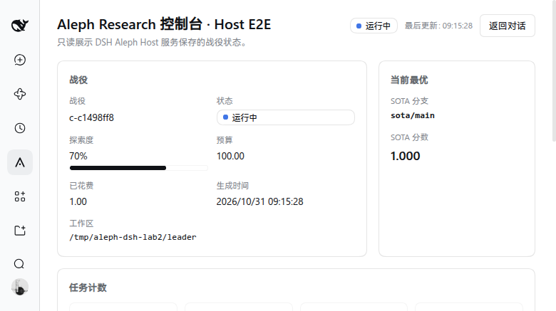

# AlephResearch

AlephResearch is a DSH-native research plugin. A Leader session runs campaigns,
dispatches researchers as DSH subagents, evaluates their single commit, and
promotes the best branch. Campaign state lives in the DSH storage domain, not in
a separate `~/.aleph` directory or an external daemon.

## What is in the bundle

- Host service: campaign queue, strategy sampling, git worktrees, single-commit
  handoff, evaluation, SOTA promotion and worktree reclamation.
- Leader tools: `aleph_start_campaign`, `aleph_status`,
  `aleph_enqueue_mission`, `aleph_run_next`, `aleph_set_exploration`.
- Modes: `Aleph Research` for the Leader and `Aleph Researcher` for one mission.
- Console: a read-only `Aleph` sidebar panel reading the Host API.
- Persistence: the `aleph_research` domain opened through `ctx.storageDomain`.

The plugin writes no `~/.aleph` pointer, dashboard file or SQLite sidecar.
Project worktrees and run artifacts stay under the selected workspace at
`.aleph/`; campaign state stays in DSH storage.

## Install

```bash
cd /path/to/aleph-research
npm install --prefix dsh-plugin
dsh plugin --profile web add "$PWD/dsh-plugin"
```

Reload the Web UI, open a workspace, and choose `Aleph Research` in the mode
picker. The `Aleph` entry in the sidebar opens the console. Installation in the
current profile requires the normal plugin approval.

For an isolated test profile:

```bash
./scripts/dsh-lab.sh
```

The script creates a private `DSH_HOME`, installs the bundle and prints the Web
Host command. It does not touch the current DSH profile.

## Start a campaign

1. Open or create a DSH workspace. Empty directories are allowed.
2. Select `Aleph Research` for the session.
3. Ask the Leader to call `aleph_start_campaign` with a title, an evaluator
   command and optional visible-data path. If the workspace has no `research/`
   repository, the tool creates an `initialize` branch and `sota/main`.
4. Call `aleph_enqueue_mission`, then `aleph_run_next`.

`aleph_start_campaign` keeps campaign state in DSH storage and creates
`research/` and `.aleph/` inside the workspace. The evaluator command runs in
the workspace and must print one JSON line containing a numeric `score`.

The researcher subagent edits only the mission worktree. It writes
`ALEPH_HANDOFF.md`; the Host service then:

- squashes every researcher commit into one commit whose parent is the mission
  base;
- embeds the handoff in the commit message with `Aleph-Mission`,
  `Aleph-Campaign`, `Aleph-Strategy` and `Aleph-Base-Commit` trailers;
- runs the evaluator, updates SOTA when the score improves, and removes the
  worktree and per-mission directory.

## Console

The `Aleph` sidebar panel reads `/api/aleph/snapshot` and shows the latest
campaign, missions, branches and counts. The panel is read-only; all control is
through Leader tools.



## Evaluation contract

The evaluator receives:

| Variable | Value |
| --- | --- |
| `ALEPH_WORKSPACE` | Leader workspace path |
| `ALEPH_SOLUTION_DIR` | Mission worktree path |
| `ALEPH_SUBMISSION` | Committed submission SHA |
| `ALEPH_VISIBLE_DATA` | Optional visible-data path configured on the campaign |

The command must emit a JSON object with a numeric `score` on its last JSON
line, for example:

```bash
python3 eval/run_eval.py
# {"score": 72.9076, "rows": 1000}
```

## Status

The Host plugin, two presets, tools, storage-domain state, console and one
end-to-end researcher dispatch have been exercised in an isolated DSH. See
`docs/STATUS.md` and `docs/architecture.md`.

The old Python control plane has been removed. The browser UI, storage schema
and researcher tools are the only supported control surface.
